  

  
  
  

## 👋 About me

**Full-Stack Developer** since 2023, building production SaaS for companies in the US and Spain since late 2024.
I mainly work with **Laravel + React/Next.js + TypeScript**, and also with Angular, NestJS, Filament and React Native/Expo.

- 🔭 Full-time primary frontend developer on **[Falcon Dispute](https://falcondispute.com)**, a multi-tenant credit-repair SaaS for Dumbo Credit.
- 💳 I enjoy the hardest parts of a product: payments (Stripe, Revolut Business, NMI), automation workflows, role-based access control and admin dashboards.
- 🎮 After hours I build games with three.js, Expo and Canvas, and automate their trailers with Remotion.
- 🤖 I use AI-assisted workflows (Claude Code), backed by typed code, tests and pull-request review.
- 🎓 Ingeniería en Ciencias Informáticas (B.Eng. in Computer Science), University of Informatics Sciences (UCI), Cuba. Graduated with a Gold Diploma.

<b>Leer en español</b>

**Desarrollador full-stack** desde 2023; desde finales de 2024 creo productos SaaS en producción para empresas de EE.&nbsp;UU. y España.
Trabajo sobre todo con **Laravel + React/Next.js + TypeScript**, y también con Angular, NestJS, Filament y React Native/Expo.

- 🔭 Principal desarrollador frontend, a tiempo completo, de **[Falcon Dispute](https://falcondispute.com)**, un SaaS multiempresa de reparación de crédito para Dumbo Credit.
- 💳 Disfruto con las partes más complejas de un producto: pagos (Stripe, Revolut Business, NMI), automatizaciones, control de acceso por roles y paneles de administración.
- 🎮 En mi tiempo libre desarrollo videojuegos con three.js, Expo y Canvas, y automatizo sus tráileres con Remotion.
- 🤖 Uso flujos de desarrollo asistidos por IA (Claude Code), con código tipado, pruebas y revisión por pull requests.
- 🎓 Ingeniero en Ciencias Informáticas por la UCI (Cuba), graduado con Título de Oro.

## 🛠️ Tech stack

  

  
  
  
  
  
  

## 🚀 Featured work

| Product | What I built | Stack |
|---|---|---|
| **[Falcon Dispute](https://falcondispute.com)** Credit-repair SaaS · US | Primary frontend developer (~75% of frontend commits): dispute workflow UI, letter builder, Stripe/MagicPay billing, AutoFalcon automation builder, and a white-label client portal built from scratch | Laravel · Inertia.js · React · TypeScript · Next.js 16 |
| **Kruceros** Cruise-booking CRM/ERP · Spain | Main developer since June 2026: Revolut Business webhooks with hourly reconciliation, quarterly commission settlements, OAuth 2.0 and SOAP integrations | Laravel · Filament · React |
| **Tourney Padel** Padel tournament platform · Spain | Main full-stack developer (350 of 535 commits): competition engine (groups, brackets, Americano format), Stripe subscriptions, push notifications, app localized into 8 languages | Laravel · Filament · Expo |
| **[Dumbo Credit](https://app.dumbocredit.com)** Credit monitoring · US | 3-bureau credit report, admin dashboard with revenue and churn KPIs, affiliate portal | Next.js 14 · MUI · TypeScript |
| **[TaxFinder](https://app.taxfinder.net)** Tax-pro marketplace · US | Admin dashboard, in-chat payments, web push notifications | Next.js 14 · TypeScript · Firebase Cloud Messaging |

Client code is private. I'm happy to walk through the architecture and decisions in an interview.

## 🎮 Side projects (AI-assisted)

| Project | Highlights | Link |
|---|---|---|
| **Battle Infinity** | 3D mobile auto-battler built with Expo + three.js and TypeScript: LAN multiplayer with deterministic lockstep, replays, and a village with a day/night cycle | demo on request |
| **Reino del Alba** | Tower-defense kingdom builder in vanilla JS + Canvas: sprite cache with LRU eviction, 78 automated smoke tests, Android build with Capacitor | [▶ Play](https://alejandroespinoperez.github.io/Game-Aldea/) |
| **Tierra Viva** | Procedural world and civilization simulator: seeded biomes and rivers, A\* pathfinding, eras from the Stone Age to the Space Age, synthesized audio | [▶ Play](https://alejandroespinoperez.github.io/Tierra-Viva-game/) |

## 📈 Activity

**2,400+ contributions in the last 12 months**, most of them in private client repositories.

<picture>
  <source media="(prefers-color-scheme: dark)" srcset="https://raw.githubusercontent.com/AlejandroEspinoPerez/AlejandroEspinoPerez/output/github-snake-dark.svg">
  <source media="(prefers-color-scheme: light)" srcset="https://raw.githubusercontent.com/AlejandroEspinoPerez/AlejandroEspinoPerez/output/github-snake.svg">
  
</picture>

## 📫 Let's talk

I'm open to **remote full-stack roles** (Laravel · React/Next.js · TypeScript) with teams in Europe and the Americas.
Reach me at **[espinoperezalejandro50@gmail.com](mailto:espinoperezalejandro50@gmail.com)**. My resume (EN) and CV (ES) are available on request.
